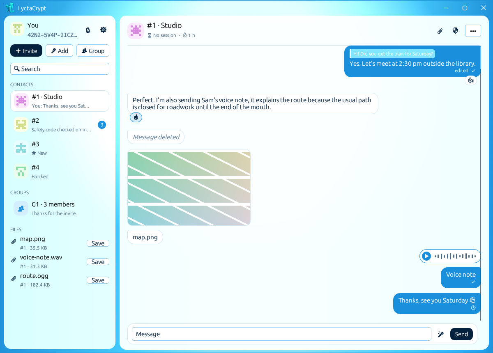

<p align="center">
  
</p>

<h1 align="center">LyctaCrypt</h1>

<p align="center">
  Private messaging with no servers, no accounts and no phone number.
</p>

<p align="center">
  <a href="https://lyctacrypt.xyz">Website</a> ·
  <a href="#install">Install</a> ·
  <a href="#how-it-works">How it works</a> ·
  <a href="SECURITY.md">Security</a>
</p>

<p align="center">
  
</p>

> **LyctaCrypt has not been reviewed by independent security experts yet.**
> Please don't rely on it where someone's safety is at stake. What it protects, and what it
> doesn't, is written down in [SECURITY.md](SECURITY.md).

## What it is

LyctaCrypt is a messaging app for your computer. Your messages go straight from your device to
the other person's, through the [Tor](https://www.torproject.org) network. There is no company
in the middle and no server holding your conversations.

- **No account.** No email, no phone number, no username. You are identified by a key that never
  leaves your device.
- **Nobody in the middle.** Messages travel directly between the two of you. There is nothing to
  hand over, because nothing is stored anywhere else.
- **Hidden location.** Tor hides where you are, even from the person you are talking to.
- **Built to last.** The encryption is designed to hold up against today's computers and against
  the quantum computers expected in the future.
- **Locked on your device.** Everything is kept in one encrypted file, opened with your
  passphrase.

## What you can do

- Send messages, pictures, files and voice notes
- Reply, react, edit and delete your own messages
- Create group chats that only the members can read
- Make messages disappear after a time you choose
- Add a contact by scanning a QR code
- Use a second device linked to your main one
- Get through networks that block Tor, in one click
- Lock the app automatically and keep it out of screenshots
- Keep a second, harmless-looking vault that opens with a different passphrase

## Install

Download the latest version for Windows, macOS or Linux from the
[Releases](../../releases) page, then open it. There is nothing else to install: Tor is built in.
If no version is published there yet, you can [build it yourself](#build-it-yourself).

The first time you open LyctaCrypt, you choose a passphrase. It protects everything on your
device, and it cannot be recovered if you forget it.

### Add your first contact

1. Click **Invite**. A QR code and a line of text appear.
2. Give it to the other person, ideally face to face. Each invite works once.
3. They click **Add** and scan or paste it.
4. Open **Verify** on both sides and check that the codes match. This proves you are really
   talking to each other.

## How it works

Each conversation gets its own private address on the Tor network, known only to the two of
you. Your app connects to theirs directly, and the messages are encrypted from one device to
the other. If the other person is offline, the message waits on your device, or in a mailbox
that a friend you trust agrees to host. That friend only ever sees scrambled data.

The details are in [PROTOCOL.md](PROTOCOL.md).

## Limits you should know

- It has not been independently audited.
- Both people need to be online at the same time, unless you set up a mailbox.
- Sending is slower than in ordinary messengers, because everything goes through Tor.
- Files are limited to 1 MB.
- There is no mobile app.
- Your contacts can tell when you are reachable.

The full list is in [SECURITY.md](SECURITY.md).

## Build it yourself

You need [Rust](https://rustup.rs). On Windows, you also need the Microsoft C++ Build Tools.

```bash
cargo build --release
```

This produces two programs in `target/release`: `lyctacrypt-gui` (the app) and `lyctacrypt`
(the same thing for the terminal).

To run the tests:

```bash
cargo test --workspace
```

## For developers and reviewers

| Read this | To find |
|---|---|
| [PROTOCOL.md](PROTOCOL.md) | How messages are encrypted and sent |
| [SECURITY.md](SECURITY.md) | What is protected, what is not, what was tested |
| [docs/AUDIT.md](docs/AUDIT.md) | Where the sensitive code lives, how to rebuild the published programs |

The code is in three parts: `crates/lycta-core` (encryption, no network), `crates/lycta-node`
(Tor and the terminal app) and `crates/lycta-gui` (the window).

Contributions are welcome, especially security reviews. Please report vulnerabilities privately
rather than in a public issue.

## License

[AGPL-3.0-or-later](LICENSE)
